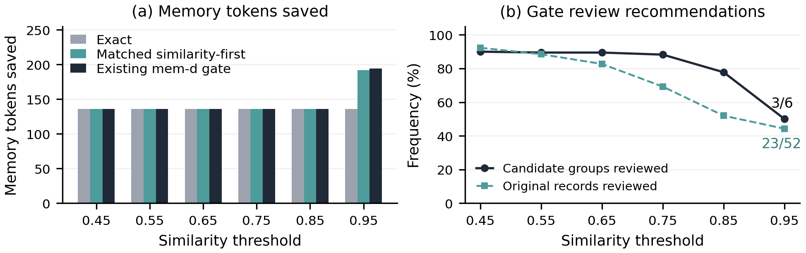
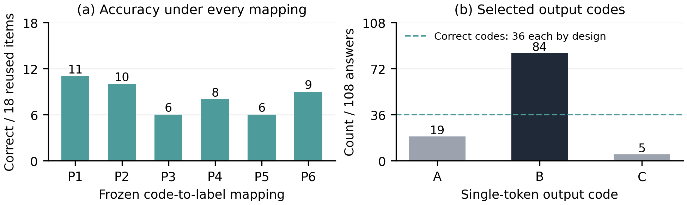

# 1. Introduction

Can mem-d identify memory merges that damage downstream decisions while allowing useful compression? Developers governing agent memory and researchers evaluating consolidation need to distinguish redundancy from changes in scope, permission, certainty, source or time. A conservative gate can look effective simply by doing less.

We contribute a paired evaluation framework; a finding that five thresholds reproduce simpler controls exactly; and a diagnostic exposing answer-mapping sensitivity. The remaining non-identical comparison has no demonstrated incremental decision benefit. We evaluate an inherited gate rather than inventing a consolidation algorithm. This exploratory feasibility study validates neither memory safety nor general model capability.

<!-- PAGE_BREAK -->

# 2. Related Work

LongMemEval [1] evaluates extraction, multi-session and temporal reasoning, knowledge updates and abstention. LoCoMo [2] evaluates long conversational memory through question answering, summarization and dialogue tasks. They motivate evidence and time distinctions; our small decision cases are not substitutes for those benchmarks.

Compression evaluated through task utility is established: LLMLingua [3] compresses prompts, while Mem0 [4] extracts, consolidates and retrieves memories with downstream QA evaluation. Recent preprints further constrain novelty. Zhang et al. [5] examine consolidation regressions and an episodic-retention control. Colaco and Lahjouji [6] frame compaction through resource budgets and downstream utility. Annapureddy and Thamatani [7] distinguish consolidation quality from governance and report a limit of their quality score's external validity. MEMOIR [8] already uses judge-gated consolidation screening. These are their reported findings, not replications here.

Our narrow distinction is testing one existing deterministic gate while holding candidate groups and replacement records fixed, using exact and budget-matched controls. We claim neither firstness nor a superior memory architecture. Zheng et al. [9] already document option-ID selection bias. Our neutral-code diagnostic is not a novel discovery of token bias or a replication of their debiasing method; it checks a specific measurement interface whose validity cannot be assumed.

# 3. Methods

## 3.1 Corpus, provenance and ground truth

The development corpus contains 20 fictional English cases in ten families, with 52 records: five duplicate controls, five decision-changing exceptions, five uncertainty/attribution distinctions and five unresolved contradictions. Domains include releases, scheduling and purchasing. Each case specifies a question, decision criteria and acceptable labels: `proceed`, `do_not_proceed`, or `insufficient_evidence`. Caveats can permit actions; unresolved evidence can justify insufficiency. Keys follow the fictional evidence and criteria, not mem-d rules. Cases and annotations were assistant-authored and lack independent human validation.

Two variants share each family; paraphrases are not independent evidence. No untouched evaluation exists. Preexisting mem-d parsing, enrichment, embeddings, policy and recommendation functionality are inherited from baseline `14af8eccc0141450d01981e189a48b72140ce754`. Sprint work adds protocol, synthetic data, the external harness and analyses. Production behavior and gate rules are unchanged. Hypothetical replacements operate on disposable copies; source memories remain intact.

<!-- PAGE_BREAK -->

## 3.2 Fixed intervention and comparison policies

Canonical ID ordering precedes local BAAI/bge-small-en-v1.5 content embeddings and cosine DBSCAN (`min_samples=2`, radius `1 - threshold`; thresholds 0.45–0.95 in steps of 0.10). The medoid maximizes mean cosine similarity to other group members; ties use lexicographic ID. Replacement preserves its complete payload, without summarization.

**Original** retains all records. **Exact** merges equal content, source and timestamp, excluding ID, retaining the smallest ID without text normalization. **Existing mem-d gate** admits the same medoids only with an unambiguous complete-group merge, consistent resolutions and keeper/removable roles, without conflict or pending approval. Missing, partial, inconsistent, review or approval-required decisions veto the whole group, preserving all records. Fabricated trust is never injected. The medoid survives even if mem-d suggests another keeper, isolating gating from keeper selection.

The **similarity-first budget control** ranks the same groups across cases by decreasing unrounded mean within-group cosine, then sorted member IDs and medoid ID. Every corpus prefix is evaluated; replacements stay within cases. This offline corpus-level allocation is not a deployable per-store policy. It followed the finding that each tiny store has at most one candidate, making the shared per-case prefix all-or-none.

For each threshold/tokenizer, choose the prefix minimizing the absolute gate/control token-savings gap, breaking ties by shorter prefix. Match only within an inclusive two-percentage-point difference in original memory tokens; retain unmatched points and all operating points. No labels, audits or solver answers enter selection. At 0.95 the frozen matched control is prefix 3; the other five use prefix 2.

## 3.3 Isolation, pairing and outcomes

Explicit allowlists give merge policies only original record ID, content, source and timestamp. Solvers receive transformed records, unchanged question/criteria/options and a fixed query time: the latest original timestamp. Code prompts additionally receive a public mapping. Evaluator labels, rationales, family/category data and decisive-evidence annotations are excluded. Sentinel replacement of annotations leaves requests unchanged.

Seeds 2026–2028 permute original IDs; survivors filter that order. Conditions are randomized within each case/model/order block. Stateless calls use pinned settings. Identical complete requests share responses only within blocks, with reuse logged. Primary paired binary error averages orders within case, cases within family, then families equally. Introduced errors use originally correct blocks; rescues use originally wrong blocks. Infrastructure failures get two identical retries, then exclude the entire paired block. Invalid/truncated outputs and overflow remain errors. Ten-family bootstrap intervals cannot establish power or equivalence.

Memory tokens count the displayed compact JSON record array, including IDs and metadata, with the pinned tokenizer. They exclude question, mapping and other prompt overhead and are not total inference savings. Review frequency counts explicit review recommendations over candidate groups, separately from reviewed records over all original records. Semantic safety/retention require actual-medoid audits and remain unscored.

<!-- PAGE_BREAK -->

# 4. Results

## 4.1 Compression and control equivalence

Five of six thresholds produce byte-identical gate, exact and matched-control survivor payloads and solver messages for all shared orders. Identical prompts cannot demonstrate a gating contribution under the same solver settings. This is stronger than equality of token totals. The original coarse operating-point gap was partly a grid limitation; adding corpus prefixes supplies intermediate budgets without improving the gate itself.

*Figure 1. Deterministic development-corpus counts with the frozen Qwen2.5-0.5B tokenizer. (a) Exact, matched similarity-first and gate token savings coincide at five thresholds. At 0.95 they save 136, 192 and 194 memory tokens. (b) Gate review frequencies have different denominators: candidate groups versus all 52 original records. Exact and similarity-first have no review mechanism (N/A); their absence from panel (b) does not imply safety. These are not inference-cost or reviewer-time savings.*

At 0.95 the gate removes three groups/records in three cases, saving 194/3,290 memory tokens (5.90%). Exact removes two groups/records in two cases, saving 136/3,290 (4.13%). The gate adds only the `dev_005` paraphrase pair, keeping `m005_1`, removing `m005_3` and retaining `m005_2`: 58 incremental tokens. The matched control removes three groups/records in three cases and saves 192/3,290 (5.84%). Its additional merge instead retains a 12-December commitment and removes a conflicting 14-December commitment in `dev_016`. Gate and control differ in those two cases. Their fixed-medoid semantic safety has not been independently reviewed.

The actual budget gap is two tokens: 0.0608 percentage points of original tokens and 1.03% of gate savings. The allowed tolerance, 65.8 tokens, would be permissive relative to such small savings; the observed residual is much smaller. Every operating point is retained rather than selected by safety or answer quality.

The gate reviews 3/6 candidate groups and 23/52 original records at 0.95. Three groups are vetoed and require approval; no explicit conflict flag appears. At lower thresholds it reviews more groups while executing only the same two exact merges. More review is not evidence of better discrimination. These findings demonstrate limited positive development compression, not validated preservation or a deployable budget policy.

<!-- PAGE_BREAK -->

## 4.2 Decision results and answer-interface validity

The historical pilot has 60 case/order observations per condition/model. Within-block identity reduces 240 logical outputs to 72 real calls per model, with 168 reuses and zero paired infrastructure exclusions. Reuse adds no independent families.

{{TABLE_OUTCOMES}}

*Table 1. Strict valid/correct counts, each listed condition separately. Calibration reuses 18 items; codes cross six mappings. Five infrastructure-failed items remain in constrained-JSON eligibility. Keys and historical scores are unchanged.*

Of 240 Qwen0.5B outputs, 233 use the wrong key, four are non-JSON and three are valid but wrong. SmolLM2's three rescues all concern `dev_002`, one family: originals already affirm the booking in prose; compression elicits valid JSON. Exact accounts for the entire gain. Each compression condition introduces 0/14 errors and rescues 3/46. Gate and controls have identical error indicators, without establishing equivalence or reasoning improvement.

The old semantic-label trie diverges at the first token; suffixes and EOS are forced. Reachability does not establish unbiased selection. Cached Qwen1.5B then used single-token A/B/C, explicit mappings and all six permutations with unchanged evidence. Frozen eligibility required ≥95% valid and ≥80% correct (103 and 87 of 108 planned pairs); no best mapping was selected.

*Figure 2. Eighteen reused items × six mappings, not 108 independent scenarios. Left: correct per 18. Right: selected codes, versus 36 correct assignments each by design. Overall: 50/108 correct; B chosen 84/108. No independent-sample intervals.*

<!-- PAGE_BREAK -->

## 4.3 Mapping sensitivity blocks a qualified rerun

All 108 neutral-code outputs are valid, but only 50/108 are correct. Accuracy by semantic class is 29/36 for proceed, 11/36 for do-not-proceed and 10/36 for insufficient evidence. Decoded predictions are proceed 60, do-not-proceed 25 and insufficient evidence 23; the latter include 13 false abstentions. Codes are A 19, B 84 and C 5. Semantic answers change across mappings for 16/18 items; seven emit B under every mapping. Only two preserve their correct semantic answer across all six.

The interface is sensitive to label-blind mapping changes. This does not isolate earlier tokenization effects, establish general incapacity or demonstrate mem-d benefit: instructions and mapping comprehension also changed. Aggregate eligibility failed, blocking the development rerun. No additional trials or qualified new paired effects exist.

# 5. Discussion and Limitations

Memory-governance evaluations can credit conservative compression, formatting changes or answer-interface behavior to a gate. Check payload identity, achieved compression and review denominators, and validate measurement before interpreting downstream differences. Syntax is insufficient; a correct abstention code is not a validated explanation.

{{TABLE_CONCLUSIONS}}

*Table 2. Boundaries of the supported contribution. Failure to demonstrate a benefit is not evidence that every gate or model is ineffective.*

Scope is narrow: 20 assistant-authored cases in ten families, tiny CPU checkpoints, one code-diagnostic checkpoint, adaptive controls/interfaces, reused calibration, no untouched evaluation and no independent human semantic reviews. Offline allocation is not per-store deployment. Missing audits preclude safety estimates. Appendix A details limitations and dual use.

# 6. Conclusion

Five thresholds reproduce simpler controls; the remaining difference has no demonstrated decision benefit. Mapping sensitivity blocks qualified inference. Finalize a bounded feasibility report. The next evidential step is independent review of existing medoid proposals; model experimentation is finished.

# Code and Data

[Repository and sprint branch](https://github.com/2Cloud-S/mem-d/tree/sprint/ai-epistemics-2026) contain the editable report, scripts, protocol and artifacts. [Frozen evidence at commit 255b73f](https://github.com/2Cloud-S/mem-d/tree/255b73fd3986844ea17292e1e8c27776a77cc9a3/research/ai_epistemics_2026) includes raw requests/responses and all historical freezes. The internal claim ledger links each headline result to its artifact. No source memories or historical scores were altered for this report.

<!-- PAGE_BREAK -->

# References

{{REFERENCES}}

<!-- PAGE_BREAK -->

# Appendix A. Limitations and Dual-Use / Ethical Considerations

**What is established.** The study establishes deterministic control equivalence and compression/review counts on a small development corpus, and mapping sensitivity in one tested code interface. It does not establish improved decisions, calibrated memory safety, general model incapacity, or deployable per-store budget performance. A preserved record is not automatically useful, and a deleted duplicate is not automatically evidence loss. The fixed-medoid proposal must be judged against the actual question, scope, certainty, attribution and time.

**Sampling and adaptation.** All 20 cases are fictional, English, assistant-authored development material, with only two to three records each. Ten shared scenario families, not variants or order repetitions, are the resampling units. Labels and arbitrary-representative safety annotations lack independent human validation. The 18 calibration items are reused across interfaces and mappings and contain related simple patterns; they are not a random sample of decision tasks. Neither their 108 repeated answers nor the 60 case/order outputs justify independent-sample significance or a precise power calculation. No untouched families were generated or evaluated. Budget controls, the 0.95 comparison and answer interfaces were selected adaptively in development, with subsequent rules frozen before execution. They are not independently preregistered confirmatory comparisons.

**Measurement and deployment assumptions.** Small CPU checkpoints, greedy decoding, canonical token choices and short explicit decision rules limit external validity. Neutral codes remove unequal output-token path lengths but retain code priors and require mapping comprehension. Correct labels do not validate rationale support, and later code interfaces collect no explanations. Full memories can already produce errors. Tiny stores create coarse compression choices; the global similarity-prefix control uses an offline corpus budget unavailable to a query-blind per-store deployment. No result licenses automatic memory deletion or generalization to longer stores, retrieval, repeated consolidation, multilingual inputs or distribution shift.

**Potential misuse.** Deduplication can selectively erase dissent, caveats, source attribution or uncertainty, making a rumor appear authoritative or manufacturing agreement. Evaluators could also select flattering thresholds, drop invalid responses, or hide review burden. This work mitigates those risks through immutable source copies, metadata-preserving replacements, whole-group vetoes, explicit unknown outcomes, label-blind selection, complete denominators and auditable failures. These engineering precautions are not independently validated safety guarantees. More review can cause fatigue and does not itself establish discrimination.

**Data and review ethics.** No real user memory, private conversation or sensitive deployment data was collected. Scenarios and sources are fictional and low risk. The author's name and email were supplied for this report; the author confirmed independent researcher status in Pakistan. Two independent blinded reviews were planned for 29 unique actual-medoid proposals, but no person has completed them. Templates remain blank; assistant checks and model outputs are not human annotation, inter-reviewer agreement or adjudication. Any future real-data use would require appropriate consent, privacy and retention controls beyond this study.

<!-- PAGE_BREAK -->

# Appendix B. Technical Provenance and Adaptive Development

**Inherited baseline:** `14af8eccc0141450d01981e189a48b72140ce754`.
**Frozen evidence head:** `255b73fd3986844ea17292e1e8c27776a77cc9a3`.
The report build independently verifies that production `memd/` files remain unchanged from baseline. Preexisting parsing, normalization, categorization, embeddings, similarity/clustering, trust/lifecycle enrichment, recommendations and read-only planning are inherited, not sprint inventions. Internal recommendation-fixture accuracy measures rule conformity and is not used as downstream evidence.

{{TABLE_MODELS}}

*Table 3. Actual frozen model identities; solver native tokenizers share their respective revisions.*

Embeddings use CPU SentenceTransformer; hashing fallback invalidates feasibility. Balanced policy and identical candidates are retained. Solvers use CPU float32, two threads, native templates and greedy decoding, with 4,096 total tokens and output caps 256 (JSON), 24 (semantic), 2 (neutral). Pins: Torch 2.6.0+cpu, Transformers 4.57.1, tokenizers 0.22.1. Manifests provide dependencies and asset hashes. No paid APIs or redistributed weights.

{{TABLE_HISTORY}}

*Table 4. Planned observations, physical calls and reuse. Attempt-log rows include unsubmitted budget failures.*

The corpus-prefix control was added after the per-case zero/one grid prevented useful matching; original grid artifacts remain unchanged. Threshold 0.95 was chosen for non-identical transformations before solver answers. Independent human audits were prospectively deferred for exploratory solver execution, not treated as satisfied. JSON constraints then reached the runtime cap; a documented forced-label fallback retained strict thresholds and keys. The user subsequently authorized one neutral-code diagnostic. Its source/settings/schedule were committed at `02d3322` before answers; it failed and model experimentation stopped. No best mapping or post-answer threshold change is used.

The initial JSON trial's source hashes were frozen before calls; commit `8703c6b` captured the unchanged files during that run, not before its first answer. Forced semantic-code source `eee2cec` and neutral-code source `02d3322` precede their answers. These are local provenance, not independent timestamped preregistration. All raw failures, reused-response ownership and original scores are retained. Full iteration details are linked from the [research README](https://github.com/2Cloud-S/mem-d/blob/255b73fd3986844ea17292e1e8c27776a77cc9a3/research/ai_epistemics_2026/README.md).

<!-- PAGE_BREAK -->

# Appendix C. Expanded Diagnostic and Reproducibility

{{TABLE_MAPPING}}

*Table 5. All six frozen mappings, without best-mapping selection. Deny means do_not_proceed; insufficient means insufficient_evidence.*

Every mapping has 18 valid answers. All gold semantic classes have 36 valid item/mapping pairs. Codes A/B/C are single tokens 32/33/34 at each actual Qwen1.5B generation boundary, with EOS 151645. Earlier semantic label paths diverged immediately: Qwen labels begin with IDs 776, 2982 and 1330; SmolLM2 labels begin with 1228, 4326 and 927. Suffixes are then forced. Reachability does not prove an unbiased interface or establish the cause of earlier errors.

For example, `interface_02` (confirmed zero markers, request one) emits B under all six mappings, yielding deny/insufficient/proceed/insufficient/proceed/deny and 2/6 correct. `interface_07` (both checks pass) emits A/A/B/C/B/C and preserves proceed correctly in all six. Full per-item records, class confusion counts and requests are in the frozen diagnostic archive. Such contrasts demonstrate mapping sensitivity without proving universal inability to follow mappings.

The proposed conditional development schedule was label-blind: sort 60 case/order pairs and assign a fixed shuffle of indices 0–5 repeated ten times, sharing the mapping within each four-condition block. It was specified before diagnostic answers but never executed because eligibility failed. A hypothetical future held-out evaluation is not reported as data.

The report's `verify_evidence.py` reads frozen archives, verifies checksums, independently reparses responses/keys and recomputes headline counts and percentages. With the cached tokenizer it also recounts the memory serializations; it never runs a model. `make_figures.py` draws only those derived values. `derived/claim-ledger.json` and `references/REFERENCE_AUDIT.md` link claims and citations to primary evidence. Passing checks establishes auditability, not scientific impact. Historical repository fixture/lint failures are documented without unrelated cleanup.

# LLM Usage Statement

OpenAI Codex assistance was used to author the synthetic cases and calibration items, implement the external harness, inspect frozen evidence, generate plots and draft this report under the user's direction. Numerical checks were recomputed from artifacts, and citations were checked against primary metadata and PDF title pages. These automated/assistant checks are not independent human semantic validation. No reviewer submissions, agreement or human verification of explanations are fabricated. The human author remains responsible for the final manuscript and metadata.
